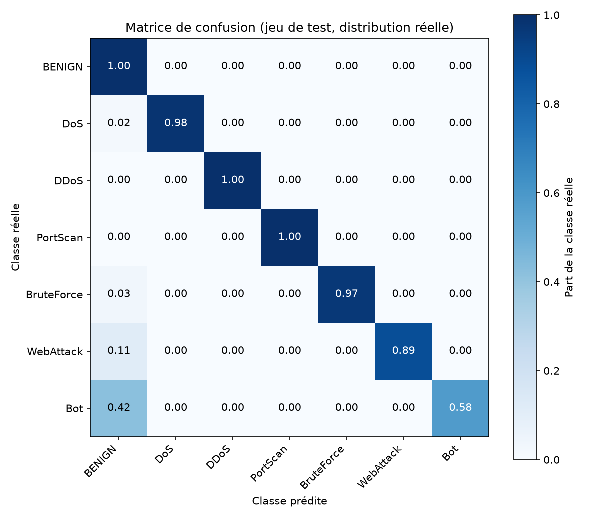
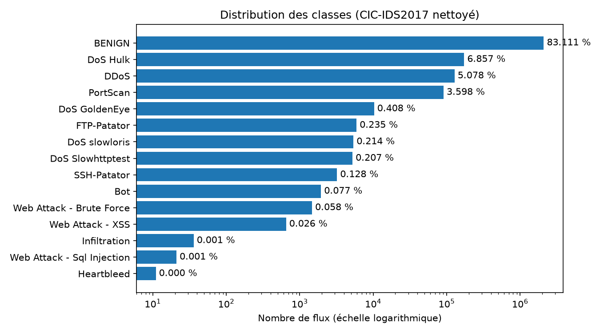
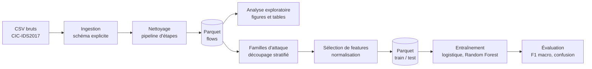

# NetSentinel


**Détection d'intrusions réseau à grande échelle avec PySpark et Spark MLlib**,
sur le dataset réel **CIC-IDS2017** (2,5 millions de flux réseau labellisés après nettoyage).

Pipeline complet et reproductible : ingestion, nettoyage, analyse exploratoire,
feature engineering, entraînement et évaluation. Le code est modulaire (principes SOLID),
testé et documenté, et chaque choix est expliqué dans `docs/`.

> Ce projet a aussi été un moyen d'approfondir la cybersécurité réseau : chaque type
> d'attaque est expliqué et relié à ce qui est mesuré dans les données
> ([glossaire de sécurité](docs/security-glossary.md)).

## Résultats

Évaluation sur 504 152 flux de test, avec la **distribution réelle du trafic**
(83 % de trafic bénin). Le jeu d'entraînement est plafonné, pas le jeu de test.

| Expérience | Accuracy | F1 macro |
|---|---|---|
| Binaire (normal / attaque), régression logistique | 0,954 | 0,921 |
| Binaire, Random Forest | 0,997 | 0,995 |
| 7 familles d'attaque, régression logistique | 0,965 | 0,591 |
| 7 familles d'attaque, Random Forest | 0,997 | 0,925 |
| 7 familles, Random Forest sans 3 features suspectes | 0,997 | 0,926 |

**À retenir**
- L'**accuracy est trompeuse** : la régression logistique affiche 96,5 % mais seulement
  0,59 de F1 macro, car elle échoue sur les classes minoritaires. La métrique de référence
  est le F1 par classe.
- Le Random Forest gagne 0,33 de F1 macro sur la baseline linéaire (7 familles).
- Six familles sur sept dépassent 0,93 de F1. **Bot** (F1 0,58) est la plus difficile.
- Retirer les trois features soupçonnées d'encoder l'outil de l'attaquant ne dégrade
  pas le modèle : elles ne sont pas nécessaires.

| Famille | Précision | Rappel | F1 | Flux de test |
|---|---|---|---|---|
| BENIGN | 0,998 | 0,999 | 0,998 | 419 012 |
| DoS | 0,995 | 0,982 | 0,989 | 38 749 |
| DDoS | 0,999 | 0,999 | 0,999 | 25 603 |
| PortScan | 0,989 | 0,998 | 0,994 | 18 139 |
| BruteForce | 0,999 | 0,968 | 0,983 | 1 830 |
| WebAttack | 0,987 | 0,886 | 0,934 | 429 |
| Bot | 0,581 | 0,580 | 0,580 | 390 |



## Données

[CIC-IDS2017](https://www.unb.ca/cic/datasets/ids-2017.html) (Canadian Institute for
Cybersecurity, Université du Nouveau-Brunswick) : cinq jours de trafic réseau capturé
dans un banc d'essai, avec des attaques réelles labellisées. Version utilisée :
`MachineLearningCSV` (8 fichiers CSV, 78 features par flux).

- 2 830 743 flux avant nettoyage, 2 520 798 après (environ 11 % retirés : doublons,
  valeurs infinies ou manquantes).
- 83,1 % de trafic bénin, 14 types d'attaque de 11 à 172 846 flux (voir
  [docs/eda-findings.md](docs/eda-findings.md)).



## Pipeline



## Démarrage rapide

Prérequis : Python 3.10+ et Java 17 ou plus (le pipeline a aussi été exécuté avec Java 23).

```bash
git clone https://github.com/douaeAya23/netsentinel.git
cd netsentinel
python -m venv .venv
source .venv/bin/activate        # Windows : .venv\Scripts\activate
make install
make test
```

Télécharge `MachineLearningCSV.zip` depuis la
[page du dataset](https://www.unb.ca/cic/datasets/ids-2017.html), décompresse les 8 CSV
dans `data/raw/`, puis :

```bash
make prepare    # CSV bruts -> nettoyage -> data/processed/flows (Parquet)
make eda        # statistiques, figures et tables dans reports/
make features   # familles, découpage, sélection, normalisation
make train      # modèles, comparaison, matrice de confusion
```

Les paramètres (chemins, graine, seuils, hyperparamètres) sont dans
[`configs/config.yaml`](configs/config.yaml). Les résultats sont reproductibles
(graine fixée, découpage par hash du contenu).

## Structure

```
netsentinel/
├── configs/config.yaml       paramètres du projet
├── docs/                     choix et analyses (voir ci-dessous)
├── notebooks/01_eda.py       exploration narrative
├── reports/{figures,tables}  résultats générés
├── src/netsentinel/
│   ├── ingestion/            lecture des CSV, schéma explicite
│   ├── cleaning/             une classe par règle de nettoyage
│   ├── eda/                  statistiques et figures exploratoires
│   ├── features/             familles, découpage, sélection, normalisation
│   ├── modeling/             modèles, échantillonnage, expériences
│   ├── evaluation/           métriques, figures, comparaison
│   └── jobs/                 points d'entrée (prepare, eda, features, train)
└── tests/                    tests unitaires (pytest)
```

## Principes de conception

- **Responsabilité unique** : chaque module fait une seule chose (lire, nettoyer,
  sélectionner, entraîner, mesurer).
- **Ouvert/fermé** : ajouter une règle de nettoyage, un sélecteur de features ou un modèle
  revient à ajouter une classe (`CleaningStep`, `FeatureSelector`, `ClassifierFactory`),
  sans modifier le code existant.
- **Inversion des dépendances** : la configuration et la session Spark sont injectées,
  jamais créées dans les modules.
- **Pas de fuite de données** : le découpage train/test précède la sélection de features
  et la normalisation, ajustées sur le train uniquement.
- Qualité : tests unitaires, lint (`ruff`), intégration continue (GitHub Actions),
  commits au format Conventional Commits et une Pull Request par fonctionnalité.

## Documentation

| Document | Contenu |
|---|---|
| [docs/data-cleaning.md](docs/data-cleaning.md) | Choix de nettoyage et leur justification |
| [docs/eda-findings.md](docs/eda-findings.md) | Constats de l'analyse exploratoire |
| [docs/feature-engineering.md](docs/feature-engineering.md) | Familles, découpage, sélection (46 features retenues sur 78) |
| [docs/modeling.md](docs/modeling.md) | Modèles, métriques, test d'ablation |
| [docs/security-glossary.md](docs/security-glossary.md) | Attaques et notions de sécurité |

## Limites

Ces scores doivent être lus avec prudence :

- **Découpage aléatoire par flux** : le fichier n'a pas d'horodatage, donc des flux d'une
  même session d'attaque peuvent se retrouver dans le train et le test. Les scores sont
  probablement optimistes. Un seul découpage, pas de validation croisée.
- **Pas d'IP ni de dates** : pas de features agrégées dans le temps (par exemple la
  périodicité d'un botnet), ce qui explique probablement en partie la faiblesse sur Bot.
- **Regroupement des classes** : le bon score sur WebAttack vient en partie du regroupement
  de trois attaques web en une famille ; il ne prouve pas que le modèle les distingue.
- **Classes rares exclues** : Infiltration et Heartbleed (moins de 50 flux) ne sont pas
  évaluables.
- **Banc d'essai contrôlé** : la généralisation à un trafic réel n'est pas démontrée. Des
  travaux publiés ont aussi relevé des erreurs d'étiquetage dans CIC-IDS2017 (par exemple
  [Errors in the CICIDS2017 dataset and the significant differences in detection
  performances it makes](https://hal.archives-ouvertes.fr/hal-03775466)).
- Hyperparamètres choisis a priori, sans recherche.

## Pistes d'amélioration

Validation croisée, recherche d'hyperparamètres, gestion explicite du déséquilibre
(pondération des classes), stockage des IP suspectes dans MongoDB, et test sur un
dataset plus récent.

## Référence

Sharafaldin, I., Lashkari, A. H., Ghorbani, A. A. *Toward Generating a New Intrusion
Detection Dataset and Intrusion Traffic Characterization*, ICISSP 2018.

## Auteure

Douae Ayachi, élève ingénieure en génie informatique (spécialisation IA).
[GitHub](https://github.com/douaeAya23) · [LinkedIn](https://www.linkedin.com/in/douae-ayachi)